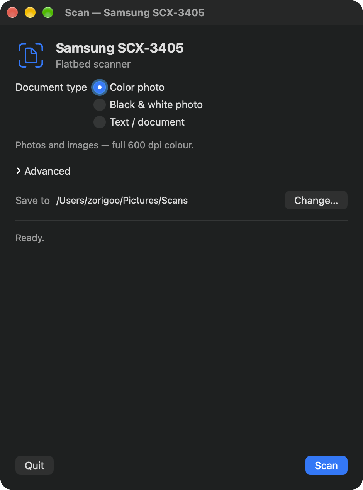

# Samsung SCX-3405 for modern macOS

**Printing and scanning for the Samsung SCX-3400 series on Apple Silicon Macs — no Samsung software, no Rosetta.**

[](https://github.com/zorigoo0128/samsung-scx3405/actions/workflows/release.yml)

Samsung never shipped an Apple Silicon driver for the SCX-3405, and the original
driver stopped working on recent macOS. This project rebuilds the open-source
[SpliX](https://github.com/OpenPrinting/splix) print driver natively for arm64 and
bundles SANE's `xerox_mfp` scanner backend into a single installer.

| | |
|---|---|
| **Printer** | any Samsung **SCX-3400 series** (SCX-3405, SCX-3405W, …) over USB |
| **Mac** | Apple Silicon (M-series), **macOS 26 or later** |
| **Result** | a working print queue **and** a clickable scanner app |

<p align="center"></p>

## Install

1. Download **`SCX3405-Full-Installer.dmg`** from the [latest release](../../releases/latest).
2. Open the disk image, then **right-click `Install SCX3405.pkg` → Open**.
   (The package is not notarized, so a plain double-click is refused. If macOS still
   refuses, run `xattr -dr com.apple.quarantine "/Volumes/SCX-3405 Installer/Install SCX3405.pkg"`
   and try again.)
3. Follow the installer and enter your password when asked.

That installs:

- a print queue named **`SCX3405`** — use it from any app (⌘P)
- **Scan SCX3405.app** in Applications
- **`scan-photo`** in Terminal

## Scanning

Open **Scan SCX3405**, pick what you're scanning, and click **Scan**. The scan is saved
as a lossless PNG in `~/Pictures/Scans`, with a preview and *Open* / *Show in Finder*
buttons. *Advanced* lets you choose the mode and resolution directly.

From the terminal:

```bash
scan-photo                 # 600 dpi colour → ~/Desktop
scan-photo ~/out.png       # or a path of your choice
```

The flatbed supports `Lineart | Halftone | Gray | Color` at
`75 | 100 | 150 | 200 | 300 | 600` dpi. 600 dpi colour takes roughly 40 seconds.
Scans are always lossless (`--jpeg=no`) — the device's built-in JPEG transfer is lossy.

## Printing

Print to **SCX3405** as usual. PDFs and plain text both work. Jobs may sit at 100 % for a
few seconds while macOS waits for printer status — that is normal for Apple's USB backend.

## Uninstall

```bash
sudo /Library/Printers/SCX3405/uninstall-scx3405.sh
```

## How it works

The installer ships **nothing** that depends on Homebrew or on network access at run time:

- **Printing** — SpliX's `rastertoqpdl` filter is compiled natively for arm64 and links
  only against the system CUPS libraries. A PPD drives the queue.
- **Scanning** — a relocatable copy of SANE (`scanimage`, `libsane`, the `xerox_mfp`
  backend and its leaf libraries) lives under `/Library/Printers/SCX3405/sane`.

Homebrew's `sane-backends` is *not* relocatable out of the box: `libsane` bakes an absolute
backend directory into the binary and offers no environment override. The build therefore
rewrites every `/opt/homebrew` install name to `@executable_path`/`@loader_path`, patches
the two compiled-in paths to the final install location, and ad-hoc re-signs the result
(required on Apple Silicon). The installed scanner loads only its five bundled libraries
plus system frameworks.

## Build from source

Requirements: Xcode command line tools, Python 3, and Homebrew `sane-backends`
(`brew install sane-backends`) — the last only as the *source* of the SANE files.

```bash
git clone https://github.com/zorigoo0128/samsung-scx3405.git
cd samsung-scx3405

./build-filters.sh              # compile the arm64 SpliX filters (optional; done automatically)
packaging/build-package.sh      # -> dist/SCX3405-Full-Installer.dmg

sudo installer -pkg "dist/Install SCX3405.pkg" -target /
```

Set `VERSION=1.2.3` to override the version baked into the package (otherwise the nearest
git tag is used).

## Releases

CI (`.github/workflows/release.yml`) builds the DMG on an Apple Silicon runner and attaches
it to a GitHub Release whenever a `v*` tag is pushed:

```bash
git tag v1.0.0
git push origin v1.0.0
```

The workflow can also be run manually (Actions → *Build installer* → Run workflow), which
uploads the DMG as a build artifact.

## Repository layout

```
build-filters.sh            build the arm64 SpliX print filters
build-tools/pkg-config      shim pinning CUPS to the system SDK
install/                    the SCX-3400 PPD used by the queue
third_party/splix/          vendored SpliX source (GPLv2) used to build the filters
packaging/
  build-package.sh          builds the .pkg and the .dmg
  patchpath.py              rewrites libsane's compiled-in paths
  scanapp/                  the SwiftUI scanner app
  sane/                     minimal SANE config (dll.conf, xerox_mfp.conf)
  scripts/                  installer preinstall/postinstall
  uninstall-scx3405.sh      uninstaller
  Distribution.xml          installer metadata and OS/arch gating
```

## Troubleshooting

- **No scanner found.** Check the USB cable and that the printer is switched on. The app
  and `scan-photo` rediscover the device automatically, so a replug is harmless.
- **`Error during device I/O` and the scan fails.** The SCX-3405's scan unit sleeps after a
  while and occasionally needs a nudge: power-cycle the printer (or replug the USB cable).
  This affects Samsung's own driver too.
- **The printer queue was not created.** The installer creates it at install time; if the
  printer was switched off, add it manually in System Settings → Printers & Scanners →
  *Add Printer*, choosing the Samsung SCX-3400 series.
- **macOS warns the developer cannot be verified.** Expected: the package is unsigned.
  Right-click → *Open*. See *Install*.

## Credits & license

- **[SpliX](https://github.com/OpenPrinting/splix)** — the print driver (GPLv2).
- **[SANE](http://www.sane-project.org/)** — the `xerox_mfp` scanner backend (GPLv2-or-later).

This project is distributed under the **GPLv2** (`LICENSE`); the scripts and app source
written here are additionally available under the **MIT license** (`LICENSE-MIT`).
